:::info[Last validated]

Last validated: November 2026. The walkthrough uses Unraid OS 7.3.4. Download the latest Installer release when following these steps.

:::

This guide covers four uses of the Unraid Installer. Install a new server onto internal storage, install remotely on a Hetzner dedicated server, reset a forgotten root password and restore the boot files from a backup.

There's [a companion video on the Uncast channel](https://youtu.be/hLjnUQWuYTw) if you'd like to follow the setup on screen. The steps and commands you need are included here.

## Choose the right installation tool

The USB Creator prepares an Unraid USB boot drive on your Mac, Windows or Linux computer. Choose it if you want to boot Unraid from USB, particularly when the server has no monitor or remote console.

The Unraid Installer runs on the target server. You need a monitor and keyboard, IPMI or another remote console to use its menu. It can create a USB boot drive or install directly onto one internal disk or two mirrored disks. Internal boot requires Unraid 7.3 or later.

The Installer USB is temporary installation media. It isn't the internal boot device you're creating.

| Download | What it does | Internet requirement |
| --- | --- | --- |
| **Bundled USB image (.img.zip)** | Creates an Installer USB with an Unraid OS release included | Not needed for the bundled OS payload |
| **Online USB image (.img.zip)** | Creates an Installer USB that downloads the OS during setup | Needed on the target server to download the OS |
| **Online installer ISO (.iso)** | Boots the Installer through virtual media or inside a VM | Needed to download the OS |
| **Linux Rescue launcher (.sh)** | Creates the temporary QEMU VM and downloads and boots the ISO. This is what we use on Hetzner | Needed to download the ISO and then the OS |

The bundled release is the version included with that Installer image. It doesn't automatically become the newest OS version after you download it. The online Installer lets you choose an available release.

Trial activation, licensing and later downloads still need internet access. For a local online installation, connect the server to your network with Ethernet before starting.

### Before you start

Prepare a spare USB stick and one or two internal target disks. Back up anything you need from those devices. Writing the Installer image erases the USB stick, and creating internal boot erases every selected internal disk, including existing data partitions.

Boot method and licensing are separate. For an installation with no permanent licensing USB, you need a supported TPM 2.0 device enabled in the server's firmware. Internal boot can also use a separate USB licensing device. See the [TPM licensing FAQ](/unraid-os/troubleshooting/tpm-licensing-faq/) and [internal boot FAQ](/unraid-os/getting-started/set-up-unraid/internal-boot-faq/) before moving an existing licence.

Leave **Secure Boot** disabled. Record the model and serial of each intended target disk so you can identify it at the erase confirmation.

## Part 1: Install on a local server

### Make the Installer USB

Open the [latest Unraid Installer release](https://github.com/unraid/bootable-unraid-installer/releases/latest) and expand **Assets**. Download the file ending in `-bundled.img.zip` for the local installation in this guide, not its `.md5` or `.sha256` checksum file.

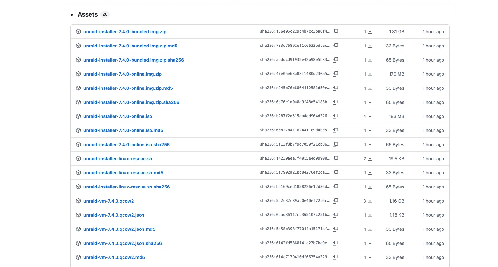

The screenshot shows Installer 7.4.0 as an example. Choose the latest release available when following the guide. Extract the downloaded ZIP to obtain the `.img` file.

Install [balenaEtcher](https://etcher.balena.io/) on your Mac, Windows or Linux computer. The same basic process applies on each platform.

1. Open Etcher and select **Flash from file**.
2. Select the extracted Installer IMG.
3. Connect the spare USB stick and select **Select target**.
4. Check the device's name and capacity. Don't select a disk containing files you need.
5. Select **Flash** and allow writing and validation to finish.
6. Eject the stick safely and connect it to the target server.

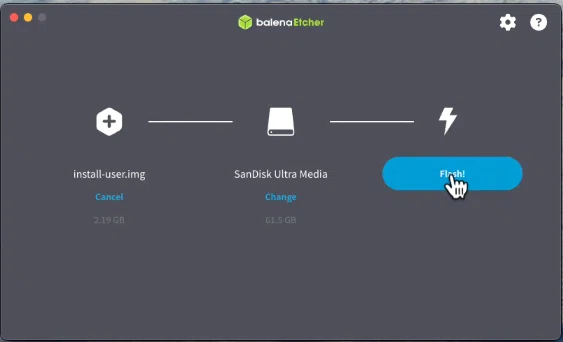

The screenshot uses a SanDisk Ultra USB. Select your own intended USB device, not the same model merely because it appears here.

### Boot the Installer and check TPM

Open the server's boot menu and select the Installer USB. The key varies by motherboard. The video uses F11 on the local machine, but your firmware's startup screen or manual gives the correct key.

Some firmware lists more than one partition from the USB. Select its bootable entry. On the machine in the video, the working entry was partition 2; this isn't a universal menu label.

If you want to license without a USB device, check TPM 2.0 in the BIOS before installing. The setting may be called **Trusted Computing**, **Security Device Support**, **Intel PTT** or **AMD fTPM**. Names and availability vary. A missing TPM in Linux doesn't by itself prove that a BIOS switch is off.

Keep **Secure Boot** disabled. Save only the intended changes and boot the Installer USB. Select **Internal Boot Setup** at its startup menu. **Memtest86+** is a separate memory-test option, not part of installation.

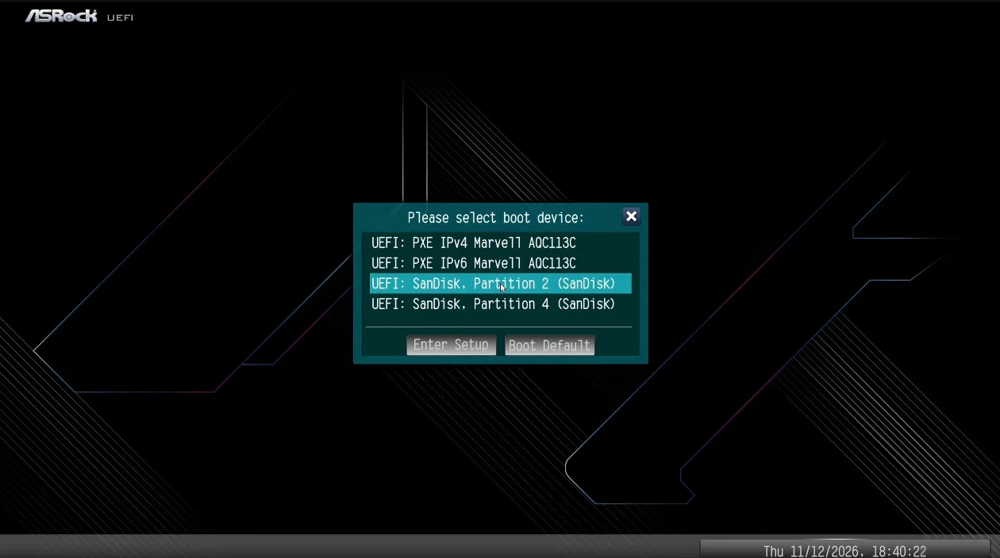

On this ASRock machine, the TPM setting is under ***Advanced → Trusted Computing → Security Device Support***. Select *Enable*, then save the intended change. The image shows the selection before it is applied, not confirmation that the OS detects TPM 2.0.

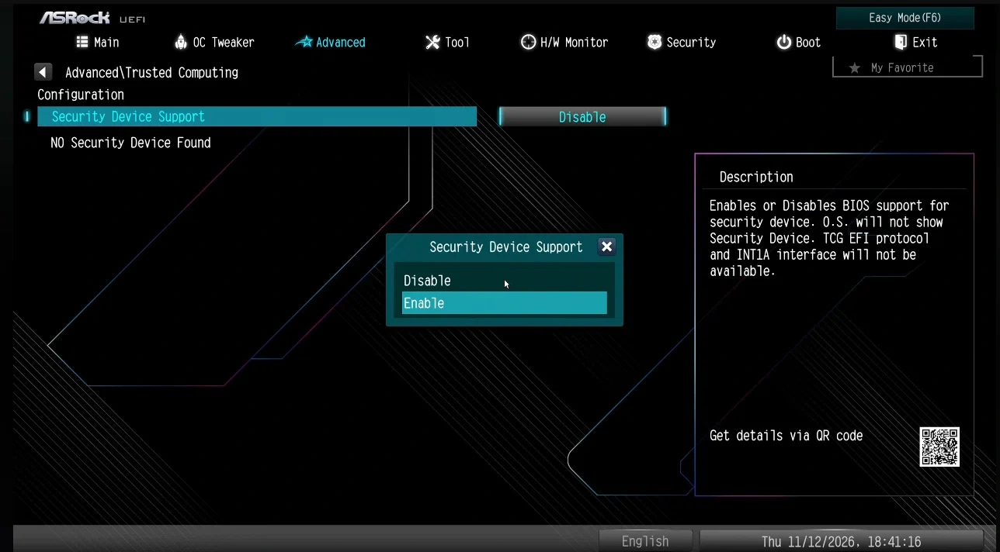

Under ***Security → Secure Boot***, check that **Secure Boot** is *Disabled*. Don't clear Secure Boot keys merely to disable Secure Boot.

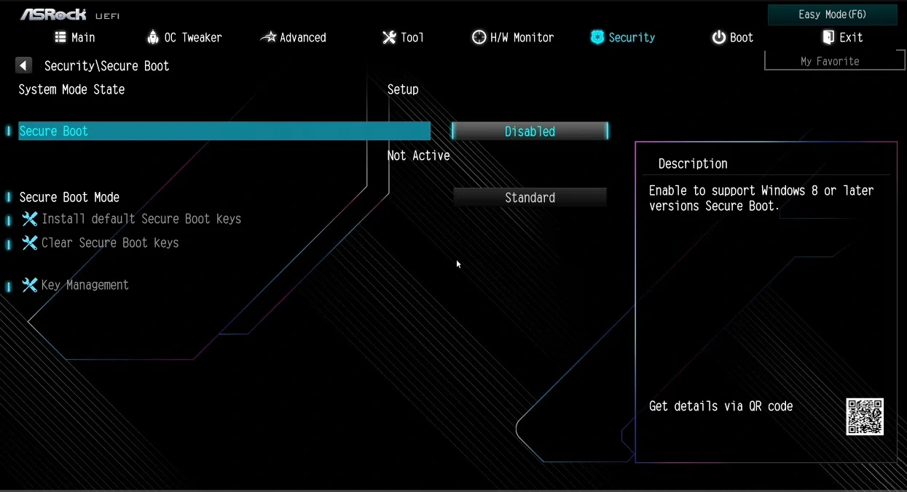

### Choose the OS and internal boot size

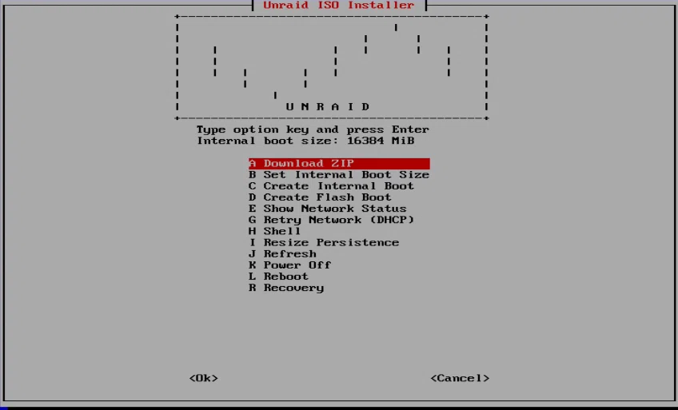

With the bundled image, the OS ZIP is already available. **A: Download ZIP** first lists downloaded ZIPs. You can keep the bundled release or choose another release when internet access is available.

With the online image, select **A: Download ZIP**, dismiss the empty-download list and select the intended release. Wait for the download to finish.

Next select **B: Set Internal Boot Size**. The default is 16384 MiB, or 16 GiB. The menu also offers 8, 32 and 64 GiB, a custom size and **Dedicated**.

A fixed boot area leaves the rest of each selected drive as partition 4, which Unraid can use for data storage. **Dedicated** reserves almost the whole disk for boot, leaving only a minimal p4. It isn't appropriate if you intend to use that drive's remaining capacity for data.

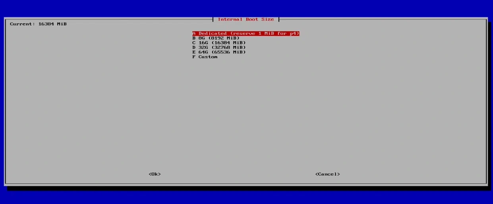

### Create internal boot

:::warning[Selected disks are erased]

This creates a new partition layout. It erases the whole selected disk, not only the space reserved for the boot area. Existing p4 data is also erased.

:::

1. Select **C: Create Internal Boot**.
2. Choose **Single disk** for one boot disk, or **Two disks (mirrored)** for a boot mirror.
3. Select the intended disk or disks. Match their model, capacity and serial to the devices you prepared.
4. Accept the default pool name, *boot*, or enter another supported name. The default avoids unnecessary changes for this walkthrough.
5. Read the erase confirmation. Continue only when every named disk can be erased.
6. Wait for **Internal Boot Complete**. You can optionally review the operation log before returning to the menu.

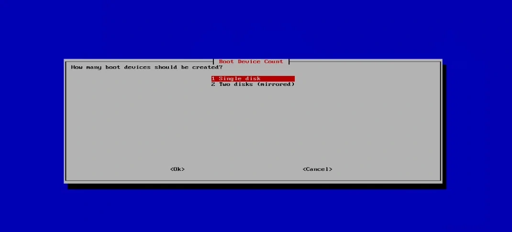

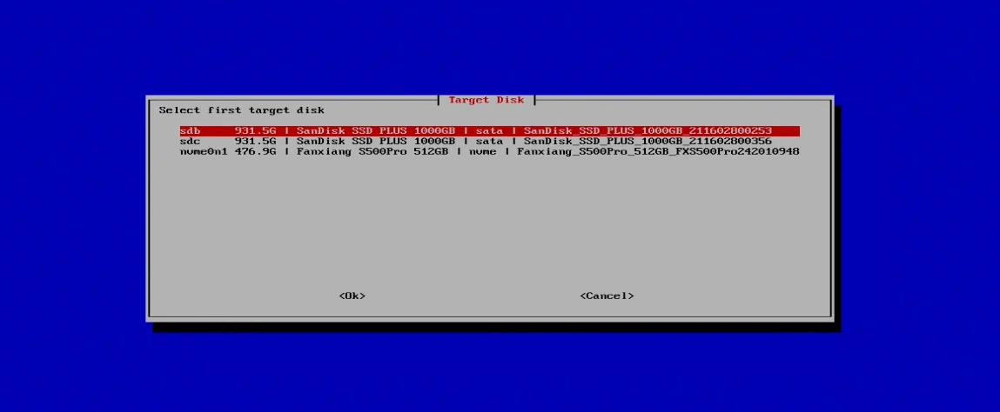

The selection image shows the list before the NVMe target was chosen. The final confirmation names `/dev/nvme0n1` for this example. Confirm your own intended device, not whichever row is initially highlighted.

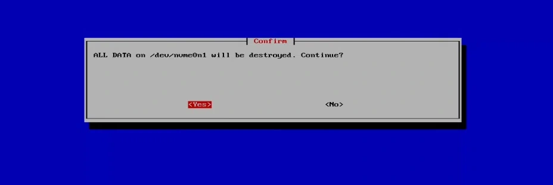

The Installer creates a ZFS boot pool, installs legacy BIOS and UEFI bootloaders and copies the OS files. With a mirror, it checks the independent EFI loaders too. Firmware boot order still matters; a completed installation isn't a test of booting from each member individually.

### Start Unraid

Reboot and select the internal drive as the boot device. Remove the Installer USB when safe, or adjust the boot order so the machine doesn't return to the Installer.

Open the address shown on Unraid's console from another computer. On a fresh setup, type the full HTTP address. For example, replace this example address with your server's address.

```text
http://192.168.1.50
```

Set a strong root password, then complete onboarding and licensing. If the browser can't open the initial page, try its login address directly.

```text
http://192.168.1.50/login
```

A supported TPM 2.0 device allows licensing without a permanent USB licensing device. If registration reports that no TPM or USB device is detected, check the firmware and the [licensing guidance](/unraid-os/troubleshooting/tpm-licensing-faq/).

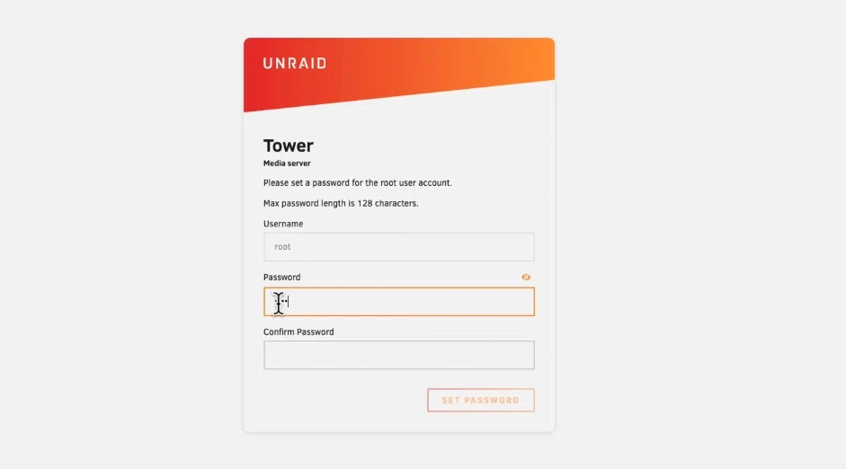

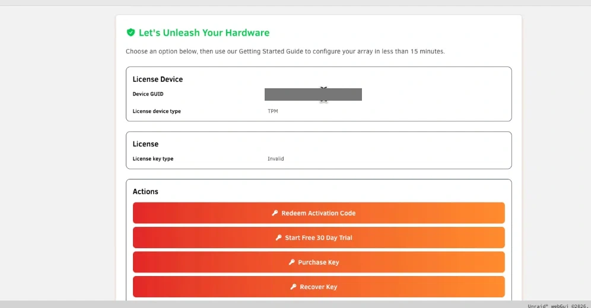

The Registration example shows a detected TPM before licence activation. Follow the registration choices for your trial, activation code or existing licence.

## Part 2: Install remotely on Hetzner

Use a dedicated server whose physical disks you can erase. This method needs hardware virtualisation through `/dev/kvm`, direct disk access and stable model and serial information. It isn't a general installation method for a cloud VPS.

The Rescue system temporarily runs a QEMU/KVM VM containing the official Installer ISO. The server's physical disks are passed into that VM. The Installer writes to them, then the server boots Unraid directly from the disks. The VM isn't part of the finished installation.

The launcher also passes the real physical disk identities into the Installer. This prevents the saved data-partition assignments from retaining QEMU's virtual model names.

### Activate Rescue and connect

In Hetzner Robot, open the correct server and select **Rescue**. Activate Linux Rescue, preferably with your SSH key selected. If you use password access, keep the temporary Rescue password private.

Activation prepares the next boot; it doesn't reboot the server. Open this server's **Reset** tab, select **Execute an automatic hardware reset** and select **Send**, as in the video. This interrupts the running OS, so first stop any work that must finish before the restart. Wait for Rescue to start.

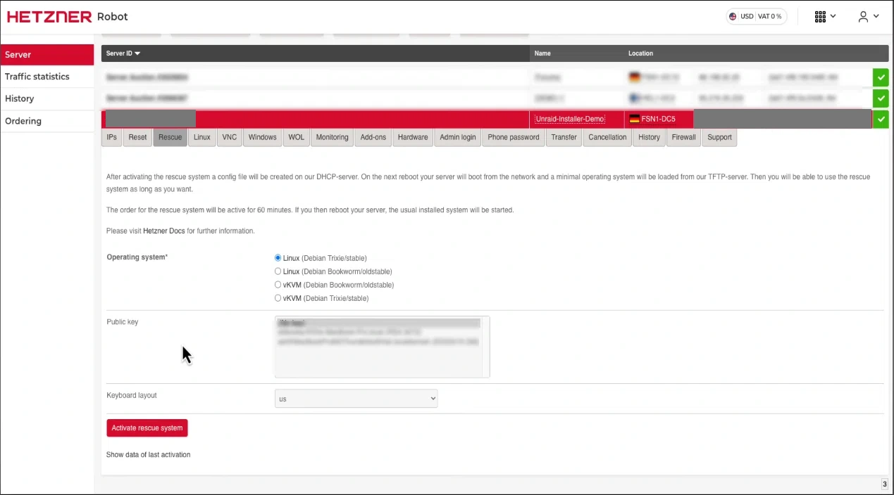

On your Mac, open Terminal. On Windows, use PowerShell or Windows Terminal with OpenSSH available. Replace `SERVER_IP` with the dedicated server's public IPv4 address, then connect.

```bash
ssh -L 5901:127.0.0.1:5901 root@SERVER_IP
```

The `-L` option sets up the VNC tunnel now, before the Installer VM starts. Leave this SSH session open while you use VNC.

Check the SSH host fingerprint against the details provided by Hetzner before accepting it. If SSH reports a changed host key, verify the new fingerprint first. Re-entering Rescue or switching between Rescue and Unraid changes the OS answering at that address. Don't remove a host-key warning without checking why it changed.

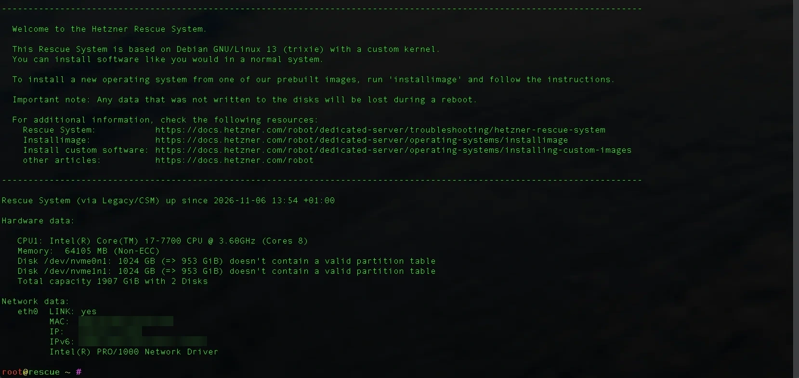

### Optional quick check: TPM licensing and server details

If you'd like to check whether Linux detects TPM 2.0 for licensing, use this command. It also shows the boot mode, motherboard model and disks, so you can identify the hardware before installing.

Run it in the Rescue SSH session, not in a terminal on your own computer. It only reads information and doesn't change the server. It hides Rescue RAM disks, loop devices and optical drives.

```bash
printf 'TPM:         %s\n' "$(v=$(cat /sys/class/tpm/tpm0/tpm_version_major 2>/dev/null) && echo "found, version $v" || echo 'none found')"; printf 'Boot mode:   %s\n' "$([ -d /sys/firmware/efi ] && echo UEFI || echo Legacy)"; printf 'Motherboard: %s %s\n' "$(dmidecode -s baseboard-manufacturer)" "$(dmidecode -s baseboard-product-name)"; echo; lsblk -e1,7,11 -o NAME,SIZE,MODEL,SERIAL
```

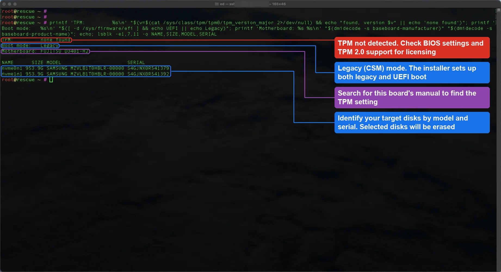

Use the results to check these four items before installing.

| Result | Why it matters | What to do |
| --- | --- | --- |
| TPM | A supported TPM 2.0 device provides the licensing identity when no licensing USB is used | Version `2` identifies TPM 2.0. `none found` means Linux can't read that version file, not proof that the device is absent or disabled. Check firmware and hardware support before licensing |
| Boot mode | Shows whether Rescue itself booted in UEFI or legacy mode | The Installer prepares both boot methods. The test server booted Unraid in legacy mode. Your firmware must support booting the intended disks |
| Motherboard | Identifies the board whose firmware settings you may need to inspect | Use its model to find the correct manual. TPM menu names differ between boards |
| Disks | Shows names, capacity, model and serial numbers, plus listed partitions | Record the intended disks and compare them with the selection and erase confirmation. Device names can change across boots |

No partitions listed doesn't prove that a disk has no recoverable data. This check doesn't inspect files or establish that the disk can be erased.

### Optional pre-flight check 2: other hosting providers

The Installer launcher worked in the Hetzner Rescue environment used for this guide, with all the required tools already available. You can skip this second check on that setup.

If you're using another hosting provider, run this check before starting the launcher. It checks whether the Rescue environment has the basic requirements to run the Installer VM. It doesn't establish that every provider is supported.

The launcher needs QEMU, hardware virtualisation, UEFI firmware for its VM and several Linux tools. The following command checks whether the tools and the expected device and firmware files are present. Run it in the same Rescue SSH session. It doesn't install packages or change settings.

```bash
m=0; for c in "QEMU:qemu-system-x86_64 qemu-kvm" "udevadm:udevadm" "lsblk:lsblk" "blockdev:blockdev" "curl or wget:curl wget" "sha256sum:sha256sum"; do f=MISSING; for b in ${c#*:}; do command -v "$b" >/dev/null 2>&1 && f=OK; done; [ "$f" = OK ] || m=1; printf '%-14s %s\n' "${c%%:*}" "$f"; done; [ -c /dev/kvm ] && k=OK || { k=MISSING; m=1; }; printf '%-14s %s\n' "/dev/kvm" "$k"; o=MISSING; for p in /usr/share/OVMF/OVMF_CODE_4M.fd /usr/share/OVMF/OVMF_CODE.fd /usr/share/edk2/ovmf/OVMF_CODE.fd /usr/share/edk2/x64/OVMF_CODE.4m.fd /usr/share/edk2/x64/OVMF_CODE.fd /usr/share/qemu/OVMF_CODE.fd /usr/share/qemu/ovmf-x64/OVMF_CODE-pure-efi.fd; do [ -r "$p" ] && [ -r "${p/CODE/VARS}" ] && o=OK; done; [ "$o" = OK ] || m=1; printf '%-14s %s\n' "OVMF" "$o"; echo; [ "$m" = 0 ] && echo "Listed requirements found. The launcher will perform further checks." || echo "Some requirements are missing. See the guidance below before continuing."
```

The tested Hetzner Rescue environment returned `OK` for all eight items. Other providers and Rescue images can differ.

```text
QEMU           OK
udevadm        OK
lsblk          OK
blockdev       OK
curl or wget   OK
sha256sum      OK
/dev/kvm       OK
OVMF           OK
```

Each item has a separate role.

| Check | What it is needed for |
| --- | --- |
| QEMU | Creates and runs the temporary Installer VM. Either executable name is accepted |
| udevadm | Reads physical disk properties, including the model and serial used for identity handoff |
| lsblk | Lists disks and their partitions and mount points |
| blockdev | Queries disk capacity and flushes disk buffers |
| curl or wget | Downloads the released Installer ISO and its checksum |
| sha256sum | Checks the downloaded ISO against its published SHA-256 checksum |
| /dev/kvm | Provides kernel access to hardware virtualisation for the VM |
| OVMF | Supplies a readable CODE/VARS firmware pair at a location the launcher searches. This gives the VM UEFI firmware independently of Rescue's own boot mode |

An `OK` result confirms presence, not full operation or compatibility. It doesn't test network access, disk safety, KVM permissions or a complete VM boot. The launcher performs additional checks when it starts.

If QEMU or OVMF is missing on a Debian or Ubuntu Rescue system, install the relevant packages. This command is for a root session and requires internet access.

```bash
apt update && apt install -y qemu-system-x86 ovmf
```

That command doesn't install every tool in the table. If another item is missing, use your Rescue distribution's package documentation. Firmware stored outside the listed locations also needs review against the launcher's supported paths.

If `/dev/kvm` is missing, check BIOS virtualisation settings, kernel module availability and the provider's restrictions. It isn't resolved merely by installing QEMU. Intel VT-x or AMD-V/SVM may need enabling in firmware. A virtual server may need nested virtualisation from its provider, and this installation method also requires direct access to the intended physical disks.

See the [official Linux Rescue instructions](https://github.com/unraid/bootable-unraid-installer/blob/main/docs/linux-rescue-install.md) for the complete environment requirements.

### Run the Rescue launcher

Download and run the released launcher in the Rescue SSH session.

```bash
curl -fsSL https://github.com/unraid/bootable-unraid-installer/releases/latest/download/unraid-installer-linux-rescue.sh -o /tmp/unraid-installer-rescue.sh && bash /tmp/unraid-installer-rescue.sh
```

This command is for a root Rescue session. Hetzner Rescue in the video didn't have `sudo`, and root doesn't need it.

Review the disk list before answering the pass-through question. The launcher excludes disks it finds mounted or in active use. A disk being offered doesn't mean its contents are disposable.

After confirmation, the launcher downloads its matching ISO, verifies its SHA-256 checksum and starts the temporary VM. It prints the VNC tunnel command and a fallback installation command containing the real disk IDs. Normally the Installer reads those identities automatically.

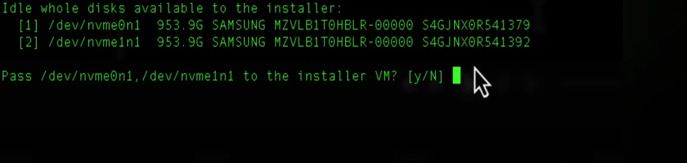

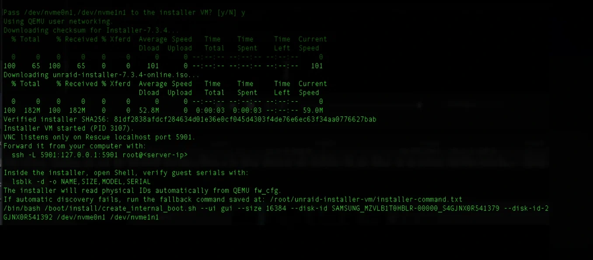

The screenshots show the release used for the video. The current launcher downloads the matching ISO for its own release.

### Open the Installer in TigerVNC

Install [TigerVNC Viewer](https://tigervnc.org/) on your computer. It is free and available for macOS, Windows and Linux. On the Mac used for the video, it was installed with Homebrew.

```bash
brew install --cask tigervnc-viewer
```

Keep the SSH tunnel open. In TigerVNC's **VNC server** field, enter the loopback address and port.

```text
127.0.0.1:5901
```

If your viewer requires an explicit port separator, use its documented address format. In TigerVNC, two colons make the port explicit.

```text
127.0.0.1::5901
```

The Mac's included Screen Sharing client requested a password in this test, but the launcher's VNC server doesn't set one. TigerVNC connected successfully.

Never open VNC port 5901 to the internet. The launcher binds it to Rescue localhost, and SSH carries the connection securely. If the viewer warns that VNC itself is unencrypted, check that you're connecting to the loopback address through the SSH tunnel.

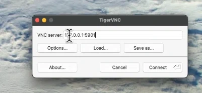

After connecting, the Installer menu appears in the viewer.

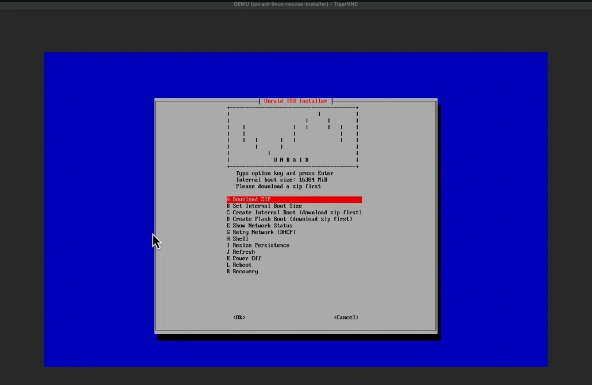

### Create the mirrored internal boot

1. Select **A: Download ZIP** and download the intended Unraid release.
2. Set **B: Set Internal Boot Size** to 16 GiB, or choose the boot area you need.
3. Select **C: Create Internal Boot**, then **Two disks (mirrored)**.
4. Select the first and second physical target disks and accept the default pool name if suitable.
5. Confirm that all contents of both selected disks can be erased, then continue.
6. Review the completion log for errors and the physical disk identity handoff.

For an optional view of what the VM sees, open **H: Shell** and run this.

```bash
lsblk -d -o NAME,SIZE,MODEL,SERIAL
```

The VM reports a QEMU model but retains the physical serials. Type `exit` to return to the menu. The launcher-to-Installer handoff supplies the physical model and serial combination saved for the installed server.

When installation finishes, choose **K: Power Off** and wait for the VM to stop. Don't boot the installed Unraid inside this temporary VM. Doing so can replace physical disk assignments with QEMU identities.

### Restrict the firewall before the first Unraid boot

A fresh Unraid installation has no root password until you set one. Restrict public access before booting it. Don't expose its WebGUI, SMB or other management services to everyone.

In Robot, open this server's own **Firewall** tab, not an account-wide template. These example incoming rules permit access from one public IPv4 address and permit TCP and DNS replies. Outgoing traffic is allowed except for Hetzner's own mail-port restrictions.

| Name | Version | Protocol | Source IP | Source port | Destination port | TCP flags | Action |
| --- | --- | --- | --- | --- | --- | --- | --- |
| Your access | ipv4 | * | YOUR_PUBLIC_IP/32 | Empty | Empty | Empty | accept |
| TCP replies | ipv4 | tcp | Empty | Empty | 32768-65535 | ack | accept |
| DNS replies | ipv4 | udp | Empty | 53 | Empty | Empty | accept |

Use your actual public IPv4 address, not the dedicated server's address. `/32` limits the rule to that one address. Empty fields mean no restriction on that field.

Keep **Hetzner Services (incoming)** enabled. Enable **Filter IPv6 packets** so an unrestricted IPv6 route doesn't bypass the IPv4 policy. These example rules don't provide general IPv6 access. Review IPv6 requirements separately if you intend to use it.

Remove the incoming **Allow all** rule when the replacement rules are ready. Don't leave an all-matching **discard** rule above the exceptions. Robot processes rules from top to bottom and drops unmatched traffic automatically. Apply changes only to the intended server.

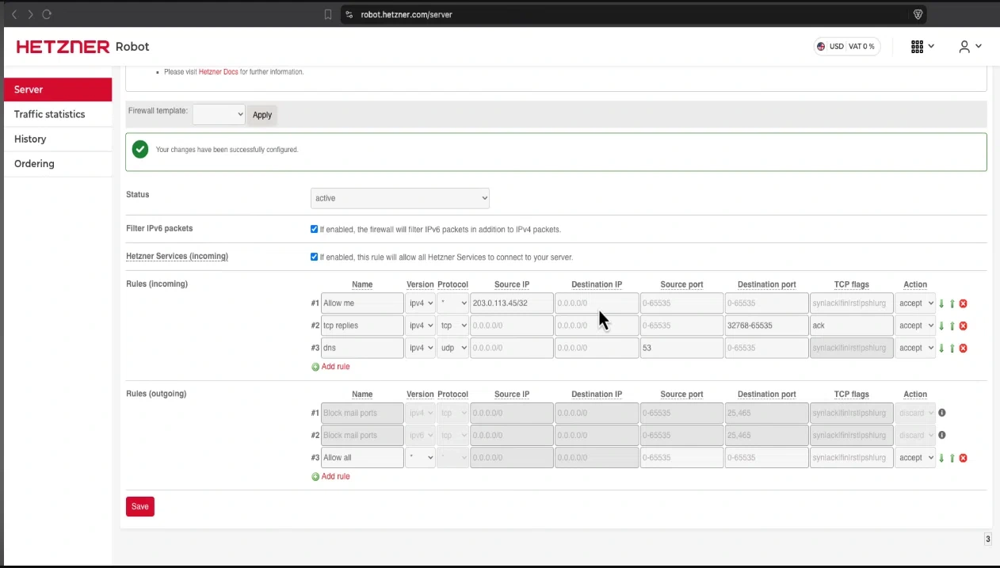

The screenshot uses `203.0.113.45/32`, an address reserved for documentation. Replace it with your own public IPv4 address before saving. Don't copy that example address into an active access rule.

These are initial IPv4 rules, not a complete firewall policy for every service. They don't explicitly allow replies from external NTP time servers or direct Tailscale UDP. Add the rules your setup needs. Hetzner's stateless firewall doesn't automatically recognise reply traffic. See [Hetzner's firewall documentation](https://docs.hetzner.com/robot/dedicated-server/firewall/).

After saving, test a new SSH connection from the allowed address before rebooting. If your home IP changes, update the rule through Robot. Don't broaden it to an ISP-wide range merely to avoid updates.

### Boot Unraid and check licensing

Make sure the Installer VM is off. Rescue activation normally applies to one boot. Check that Rescue isn't armed again for the next boot.

In Robot, open the correct server's **Reset** tab. Select **Execute an automatic hardware reset**, then **Send**, as shown in the video. This restarts the physical server, which should now boot Unraid from its own disks.

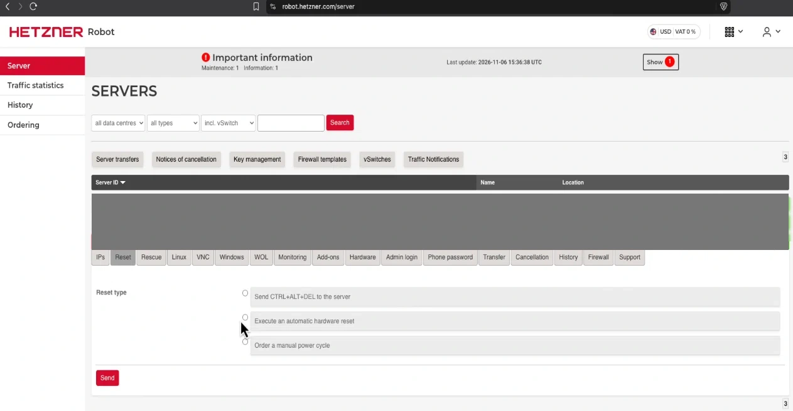

Wait for the server to boot from its internal disks, then open its full HTTP address. Set the root password before continuing. If necessary, use `/login` as described in Part 1. A successful ping alone doesn't prove that the WebGUI is ready.

Continue through the onboarding wizard and review the disk assignments in the WebGUI. An unformatted p4 is not the same as a missing disk. Don't format a data partition containing files you need.

If no TPM or USB licensing device is detected, enable a supported TPM 2.0 device in firmware or use a supported USB licensing device. The server in the video required a firmware change through Hetzner's remote console.

### Enable TPM through a remote console

In Robot, open the correct server's **Support** tab and request **Remote Console**. Hetzner offers an immediate request or an appointment. Its [KVM console documentation](https://docs.hetzner.com/robot/dedicated-server/maintenance/kvm-console/) describes the free three-hour period and current terms.

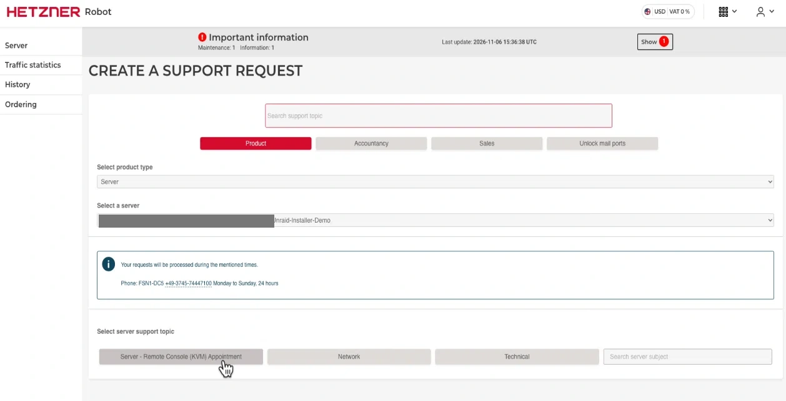

When the console is connected, Hetzner sends its address and login details by email. Keep those credentials private. This hardware console is different from TigerVNC: it shows the real server, including its BIOS screens.

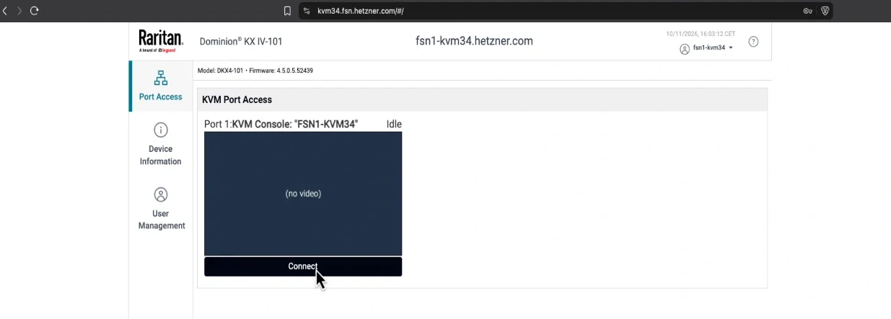

The example uses a Raritan console. Select **Connect** to open its video session. The preview can report no video before a connection is established; that alone doesn't confirm a server fault.

1. Open the console and select its keyboard/video session.
2. Reboot Unraid cleanly and focus the console's video area.
3. Press the motherboard's BIOS setup key during startup. On a Mac keyboard, you may need Fn with the function key.
4. Open the relevant TPM settings and enable the supported device.
5. Save the intended change and reboot without altering unrelated boot settings.

On the Fujitsu server in the video, the setting was ***Advanced → Trusted Computing → TPM Support***. The BIOS used **F4: Save & Exit**. These names and keys aren't universal.

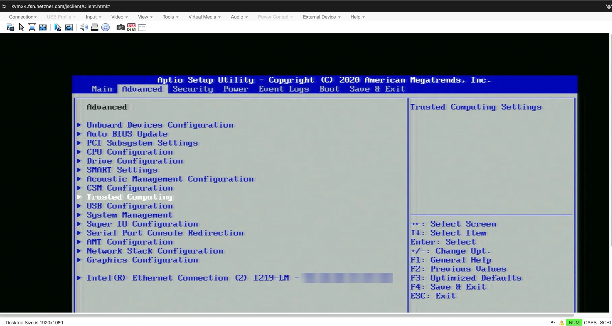

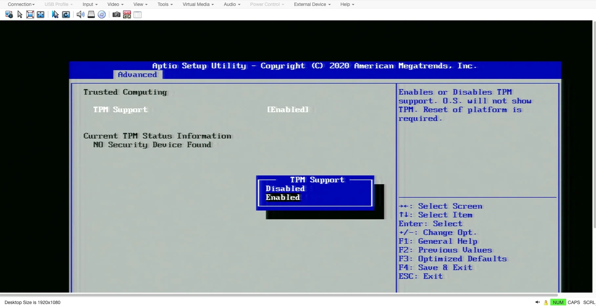

The screenshot shows the selected setting, not proof of a working TPM. After saving and rebooting, check that Unraid's Registration page offers a TPM identity, as shown in the video.

For an optional additional check in Unraid's terminal, run these commands. This terminal check isn't needed to follow the video.

```bash
ls -l /dev/tpm0
cat /sys/class/tpm/tpm0/tpm_version_major
```

A version of `2` identifies TPM 2.0. If it's still absent, check firmware options and actual hardware support rather than assuming the switch was sufficient. Don't select a TPM-clear operation merely to enable it.

You can instead ask the provider whether its support team will enable TPM for you. Service availability varies. Agree the downtime and request that unrelated BIOS settings remain unchanged.

The TPM device type on the Registration page, illustrated in Part 1, confirms that Unraid has detected a licensing device. The local and remote machines can use different firmware menus.

For ongoing access, consider [Tailscale](/unraid-os/system-administration/secure-your-server/tailscale/). After private access works, review the firewall again and remove public WebGUI exceptions you no longer need. Keep the required outbound and reply traffic for downloads and other services. Tailscale installation and connection optimisation are outside this guide.

## Part 3: Reset a forgotten root password

This recovery action operates on an existing internal ZFS boot pool. It isn't the classic USB-boot password reset procedure. It clears the root password used for the WebGUI without clearing other users or SMB passwords.

1. Shut down Unraid and boot the Installer USB on the same server.
2. Select **R: Recovery**.
3. Select **A: Reset password**.
4. Read the confirmation and continue.
5. Wait for the successful reset message, then reboot from the internal boot device.
6. Open the WebGUI and set a new strong root password.

The tool refuses to modify an already imported boot pool. It needs to mount the existing internal boot dataset from the Installer environment.

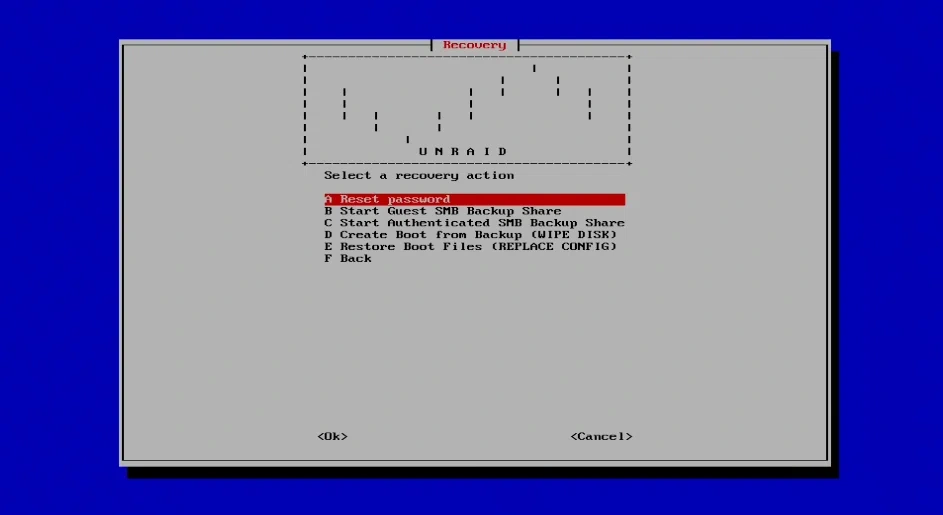

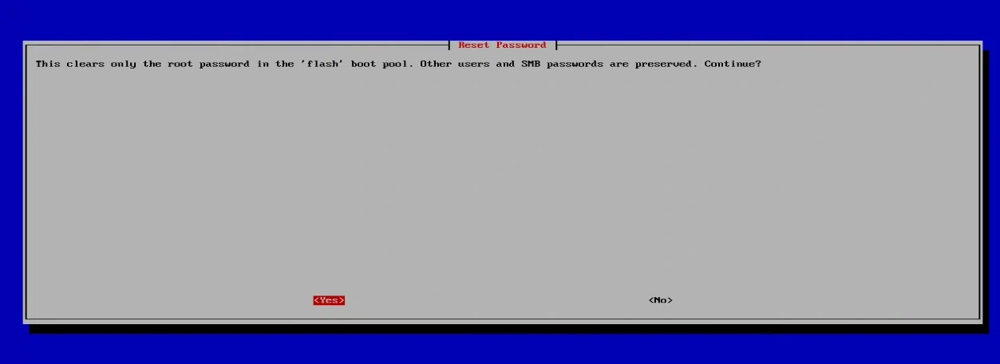

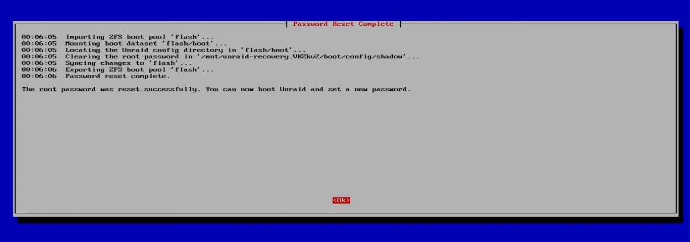

Physical or remote console access to boot media is administrative access. Keep the server and its remote-management accounts protected.

## Part 4: Restore a boot backup

A boot backup contains the OS files and saved configuration. It isn't a backup of your array, p4 data, container appdata or VM disks. Keep separate backups of that data.

Use a backup from the same server for this walkthrough. Restoring another server's configuration also brings its disk assignments, network settings, users and startup scripts. It isn't an automatic migration of those settings to different hardware.

### Create and keep the backup

In the working Unraid WebGUI, open the **Internal Boot** device page from **Main**. On the **Boot Device** tab, select **Boot Device Backup**. Download the ZIP to a separate computer and keep it intact.

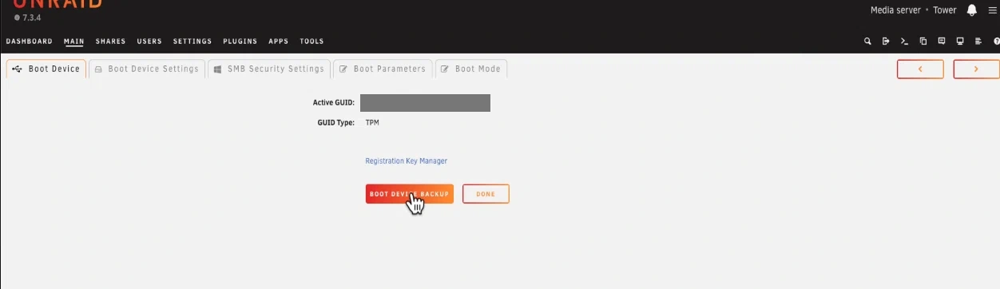

Keep an off-server copy. A backup stored only on the same physical drive won't protect against that drive failing.

### Upload the ZIP through the recovery share

Boot the Installer USB and open **R: Recovery**. The USB image provides persistent storage for the uploaded ZIP. The ISO-only Hetzner setup doesn't automatically provide the same writable persistence area.

Choose **Start Authenticated SMB Backup Share**. The guest option also exists, but Windows can block guest SMB access. The authenticated option works from a Mac too.

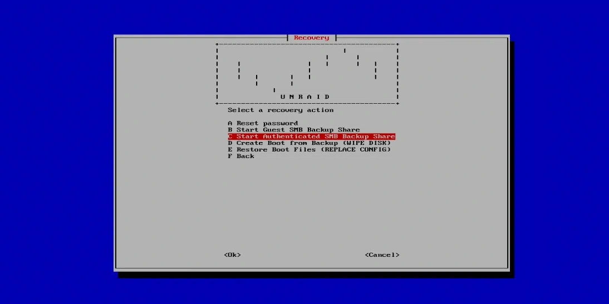

:::warning[Starting the share removes Installer OS ZIPs]

The confirmation deletes downloaded Installer ZIPs from its persistence ZIP directory, including the bundled OS ZIP if present. It doesn't delete your installed internal boot pool. You may need to download the OS again before a later fresh install.

:::

Accept that confirmation only when you're ready. The Installer shows a share named **Unraid-Recovery** and these temporary credentials.

```text
Username: ur
Password: ur
```

Use the Installer's displayed address, not an example copied from this guide. On Windows, enter the share in File Explorer.

```text
\\192.168.1.50\Unraid-Recovery
```

On macOS, open ***Finder → Go → Connect to Server***, or press Command-K, and use an SMB URL.

```text
smb://192.168.1.50/Unraid-Recovery
```

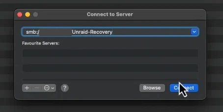

The screenshot uses the test server's local address. Replace it with the address displayed by your Installer.

Choose **Registered User** when prompted and enter the credentials. Copy the original backup ZIP into the share without extracting it. Wait for the copy to complete before selecting it in the Installer.

The fixed credentials and guest share are only suitable for a trusted network. The temporary service runs until the Installer reboots. Don't expose SMB ports on a public server to transfer a backup.

### Choose the correct restore action

These actions have different effects on the disks.

| Recovery action | What it replaces | Data partition p4 |
| --- | --- | --- |
| **Create Boot from Backup (WIPE DISK)** | Recreates the selected disks' layout and builds boot from the backup | Erased with the rest of each selected disk |
| **Restore Boot Files (REPLACE CONFIG)** | Replaces files in the existing internal boot dataset | Not repartitioned or formatted by this action |

For the in-place recovery demonstrated here, select **Restore Boot Files (REPLACE CONFIG)**.

1. Select the uploaded ZIP.
2. Read the replace-files confirmation and check the intended backup.
3. Continue and wait for the restore to finish.
4. Review the operation log, then reboot from the internal boot device.
5. Confirm that Unraid starts and the expected configuration is present.

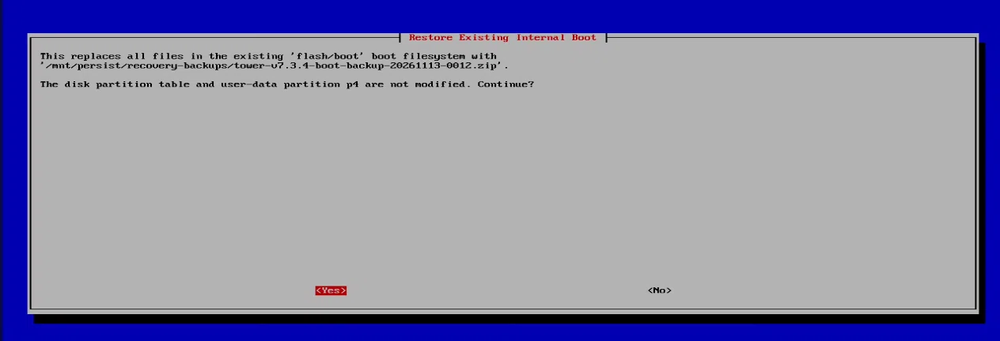

This restores the OS version and configuration contained in the ZIP, not a fresh download of the latest release. Changes since that backup are replaced.

The tool imports the existing boot pool, creates a temporary rollback snapshot, replaces the boot files and updates GRUB to the target pool's GUID. It checks restored SHA-256 files and exports the pool. The temporary snapshot is removed after a successful restore; it isn't a permanent recovery point for a later boot problem.

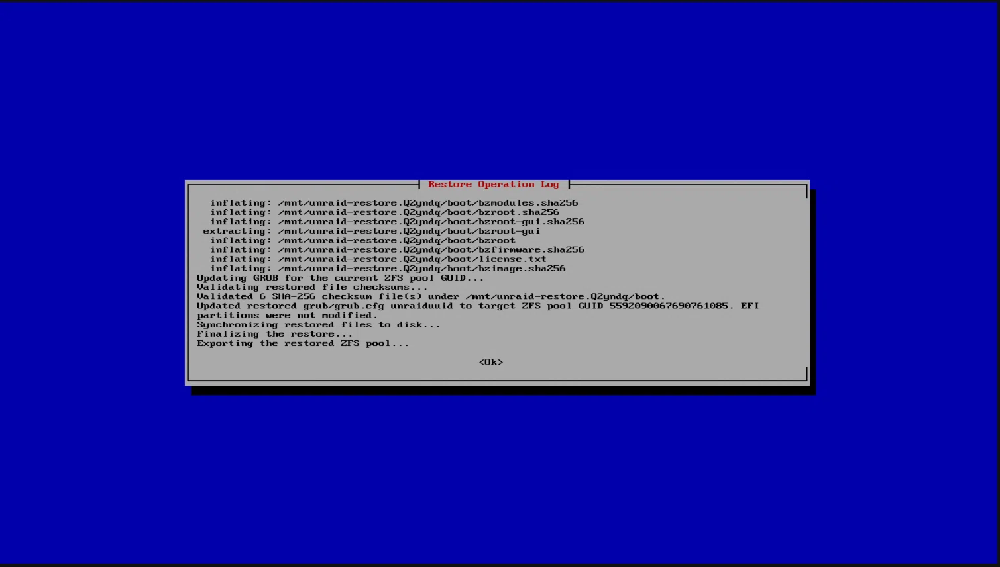

:::caution[EFI partitions are not repaired]

Restore Boot Files doesn't update the separate EFI partitions or rebuild a missing bootloader. A successful file restore isn't proof that damaged firmware boot files were repaired. The test server rebooted successfully after this restore. If the bootloader or a disk has failed, use an appropriate boot-repair or disk-replacement procedure rather than assuming this option repairs everything.

:::

### Resize Persistence is for the Installer USB

**I: Resize Persistence** expands the Installer USB's persistence partition to use available space on that USB. It stores downloads, uploaded backups and logs. It doesn't expand Unraid's internal ZFS boot pool or its p4 data partition.

On FAT32, the helper backs up the persistence contents temporarily, recreates the filesystem and restores those contents. Keep separate copies of important backups before using a resizing tool.

## If something doesn't work

### The Installer rejects a backup

Check ZIP integrity and archive layout. This internal-boot restore expects OS files, `config/` and a valid internal-boot GRUB configuration. A configuration-only ZIP or a backup nested inside an extra enclosing folder isn't the same format.

### SSH says connection refused

Check which OS is running. Activating Rescue doesn't reboot the server. If the Unraid WebGUI still answers but Rescue SSH doesn't, confirm the reboot actually happened. A refused TCP connection isn't a password or host-key failure.

### No screen appears in VNC

Keep the SSH tunnel connected and make sure the launcher reported VM startup. Connect the viewer to the local loopback port, not the dedicated server's public VNC port. If port 5901 is already used on your computer, choose another local forwarding port and connect the viewer to that local port.

### Windows or Finder cannot open the backup share

Use the authenticated share if guest access is blocked. Windows uses the backslash share path; Finder needs the `smb://` URL. Check the Installer's current IP and use the temporary credentials shown on its screen.

You've now installed onto internal storage, used a remote installation console and seen how to recover access and restore boot files. Keep the Installer USB and an off-server boot backup available, alongside separate backups of your data.
